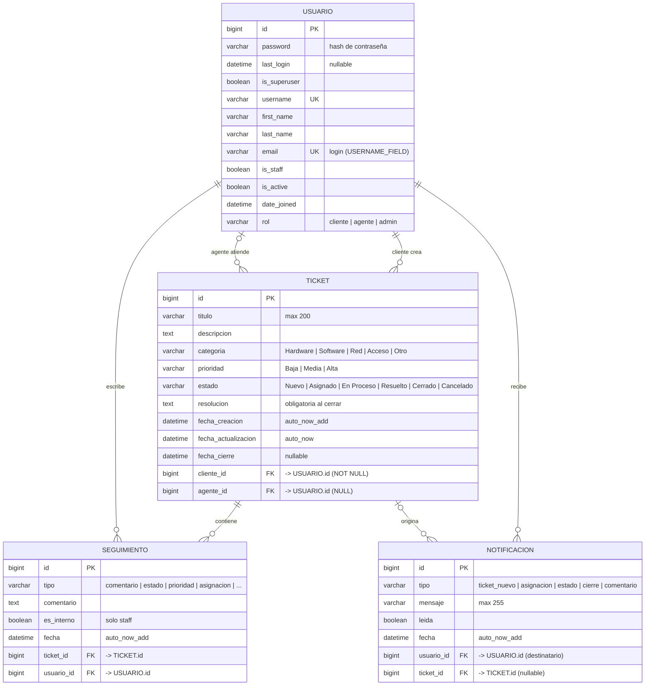

# Diagrama Entidad-Relación (ER) — Fixpoint

Diagrama basado en los modelos reales de `tickets/models.py` (Django ORM, SQLite).

## Diagrama Mermaid

## Cardinalidades

| Relación | Cardinalidad | Descripción |
|---|---|---|
| `USUARIO` → `TICKET` (cliente) | 1 a 0..N | Un cliente puede crear muchos tickets; cada ticket tiene **un** cliente. |
| `USUARIO` → `TICKET` (agente) | 0..1 a 0..N | Un agente puede atender muchos tickets; un ticket puede **no** tener agente. |
| `TICKET` → `SEGUIMIENTO` | 1 a 0..N | Un ticket tiene muchos eventos/comentarios; cada uno pertenece a un ticket. |
| `USUARIO` → `SEGUIMIENTO` | 1 a 0..N | Un usuario escribe muchos comentarios o genera eventos. |
| `USUARIO` → `NOTIFICACION` | 1 a 0..N | Un usuario recibe muchas notificaciones internas. |
| `TICKET` → `NOTIFICACION` | 0..1 a 0..N | Una notificación puede estar asociada a un ticket. |

## Notas de diseño

- **`email` es único** y es el campo de inicio de sesión (`USERNAME_FIELD = 'email'`).
- **`username`** sigue existiendo (heredado de `AbstractUser`) y también es único; se pide al registrar.
- **`rol`** es un `CharField` con choices: `cliente`, `agente`, `admin`. No es una tabla aparte.
- **`cliente`** usa `on_delete=CASCADE`: si se elimina el cliente, se eliminan sus tickets.
- **`agente`** usa `on_delete=SET_NULL`: si se elimina el agente, el ticket queda sin asignar.
- **`Ticket.estado`** por defecto es `Nuevo`; **`Ticket.prioridad`** por defecto es `Media`.
- **`resolucion`** se guarda al cerrar el ticket (junto con `estado = 'Cerrado'` y `fecha_cierre`).
- **`Seguimiento.tipo`** distingue comentarios manuales de eventos automáticos de auditoría.
- **`Seguimiento.es_interno`** oculta la nota a los clientes.
- **`Notificacion`** implementa la campana interna: no se envían correos automáticos.
- Las relaciones `related_name` son: `tickets_creados`, `tickets_asignados`, `seguimientos` y `notificaciones`.

## Tablas adicionales de Django

`AbstractUser` agrega además las tablas estándar de autenticación (no centrales para el dominio):

- `auth_group`
- `auth_permission`
- `auth_user_groups` (M2M `USUARIO` ↔ `GROUP`)
- `auth_user_user_permissions` (M2M `USUARIO` ↔ `PERMISSION`)
